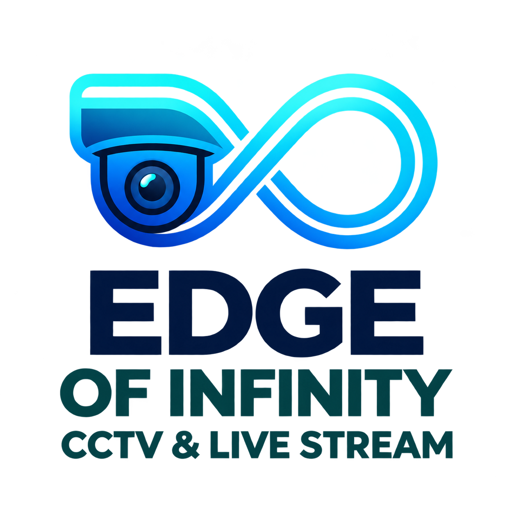

# Edge of Infinity

<picture>
  <source media="(prefers-color-scheme: dark)" srcset="logo.png">
  
</picture>

Native EdgeRTC Live, recording and indexed DVR for Home Assistant.

Version **0.17.13** adds **Settings → Setup & data → Uninstall Edge**, with
individual data categories and Delete all. Unchecked durable files are retained
without automatic re-import. The Live badge now follows rendered video rather
than stale connecting metadata. Restart HA Core after updating for the new
integration removal action. See [installation and removal](INSTALLATION.md).

- One shared camera source for Live, recording, compatible microphone and analysis.
- Original H.264/H.265 resolution/FPS, source AAC copy and 14-day retention.
- Daily DVR timeline, frame steps, sound, speed, full screen and event markers.
- Authenticated HA HTTPS/WebSocket access, including Nabu Casa.
- Optional camera/local detection, zones, alert clips and phone notifications.
- Native card with 1–4 views and separate microphone permissions.
- Dashboard cards for recordings and events that adapt to phone, tablet and desktop.

Version 0.17.2 names every add-on option in Polish and English and tightens
the dashboard bridge. Version 0.17.1 fixed dashboard cards failing with "Importing a module script
failed" after an add-on update and shows when Home Assistant must restart.

Version **0.17.12** requires completing setup before opening the panel or using
Live/DVR/camera APIs; it preserves saved profiles while their streams stay idle.
It builds on clean first-run Nabu Casa/local HTTPS guides and explicit
configuration/media removal before uninstalling. Reinstalls do not silently
restore old cameras or attach retained recordings. Normal upgrades keep existing
settings. See [clean installation and removal](INSTALLATION.md) for the
legacy-upgrade reset and the optional permanent recording deletion.

Version 0.17.8 overlaps HA startup requests and remembers positive exact-profile
codec capabilities without retaining decoders. It also limits compiler resources
during installation on small HA hosts; playback quality/pacing are unchanged.

Version 0.17.7 supports the Supervisor's tokenless Unix socket for verified old
engine options cleanup and camera-settings sync. Known MediaMTX/Janus artifacts
are removed safely; the restart notice displays the original Edge icon.

Version 0.17.6 adds fast cached dashboard galleries and debounced DVR loading, retains
original MP4 downloads and reduces competition between offscreen players,
thumbnail requests and visible streams. Vertical dashboard swipes no longer
seek the archive. Existing card YAML, themes and interface languages remain
available. Restart Home Assistant Core and reopen the panel/dashboard after
updating to load the integration and frontend together.

See [configuration, migration and playback](DOCS.md).

Local Live, DVR and HA cards require no cloud subscription. See [optional local HTTPS setup](DOCS.md#local-https-without-nabu-casa).
